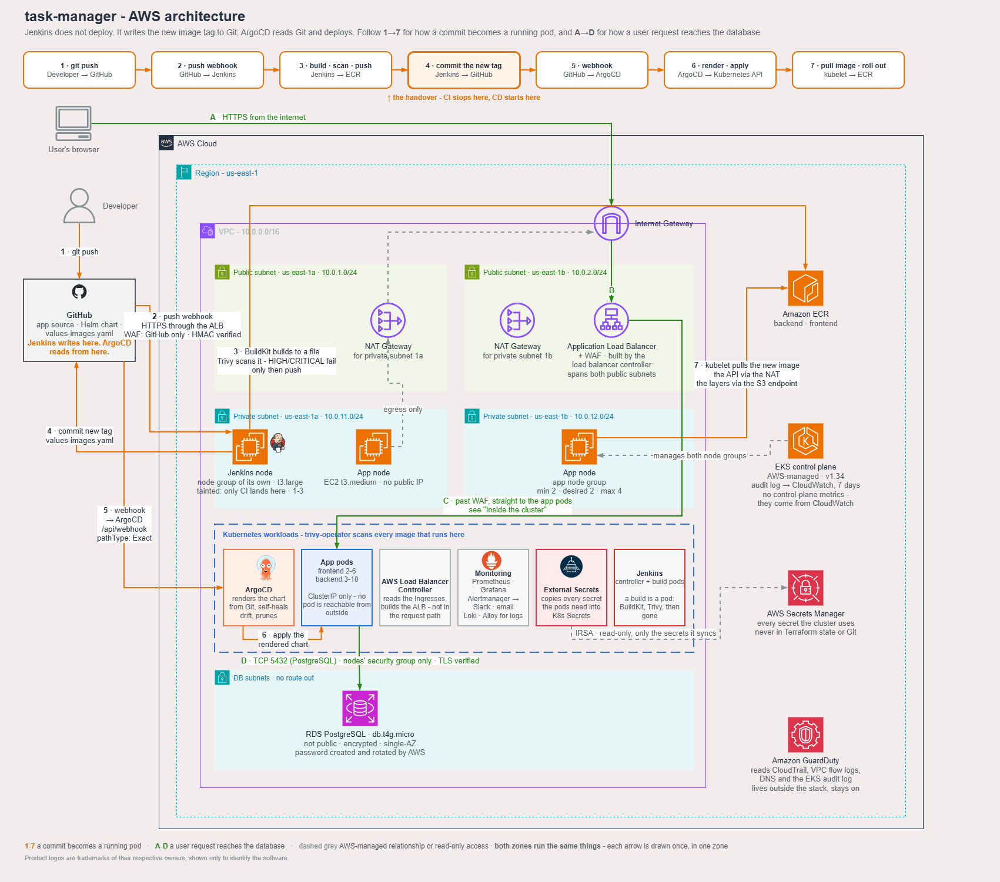
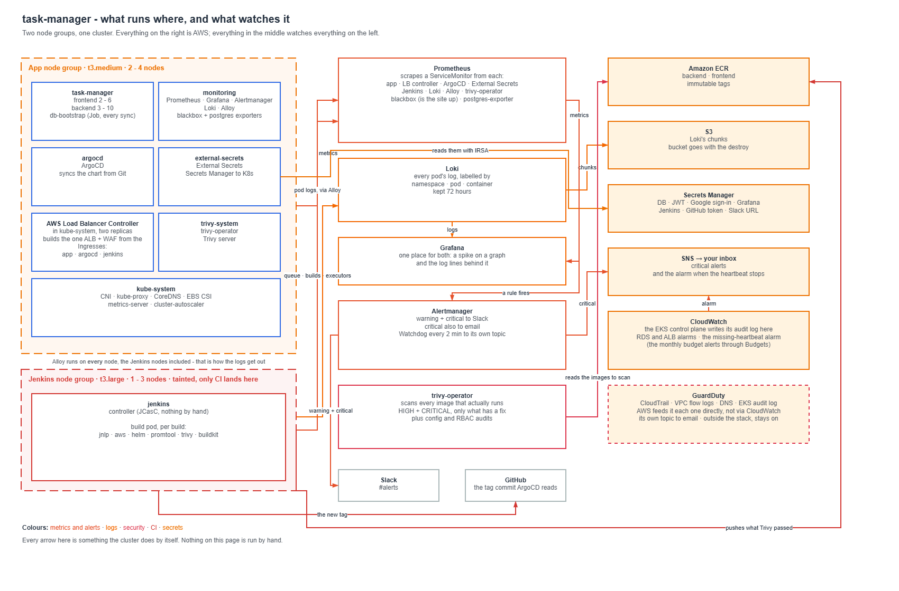
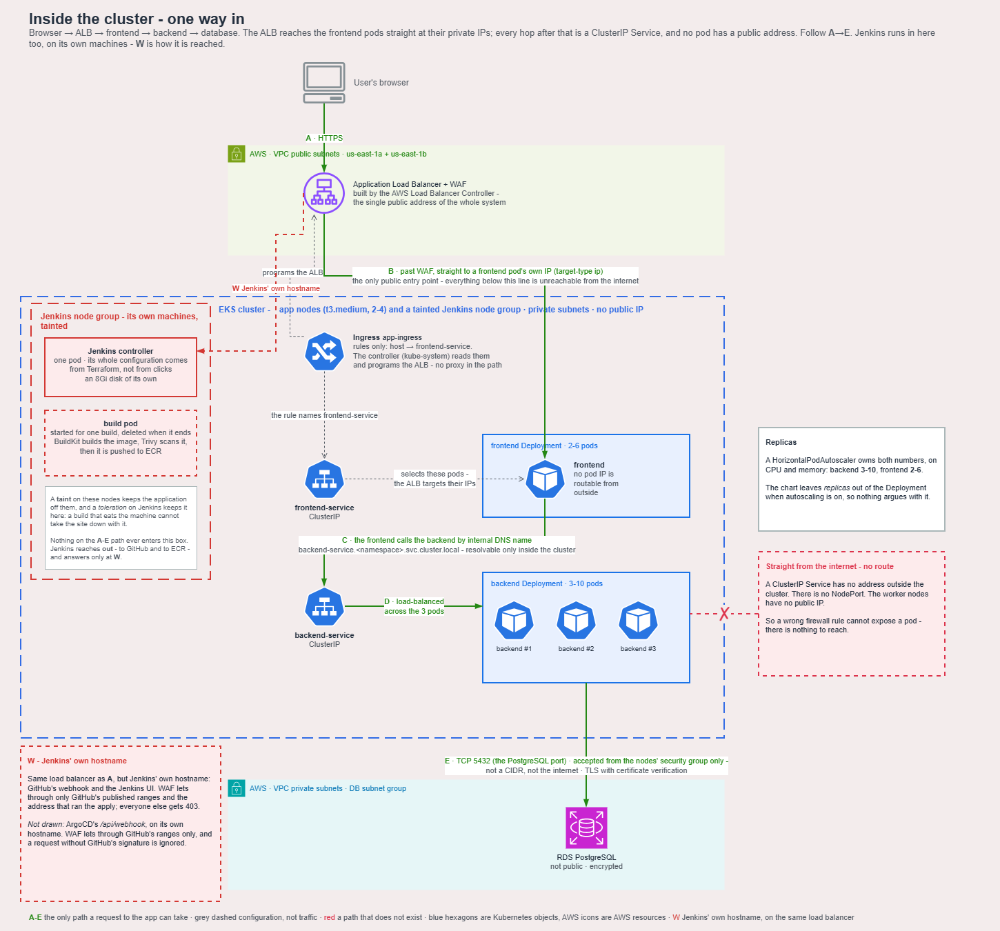
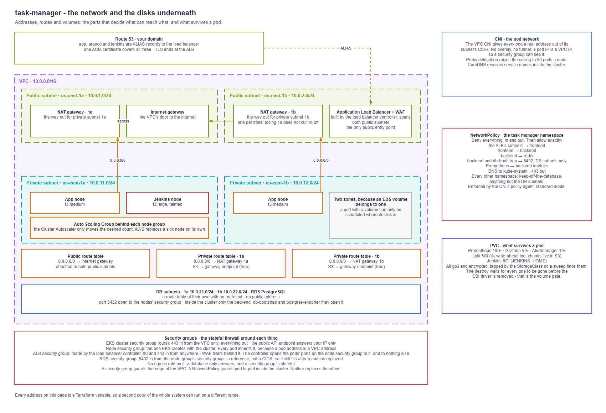

# High Level Design

## The idea in one line

**Jenkins does not deploy.** It writes the new image tag to Git. ArgoCD reads Git and deploys.

That split is why a compromised build can't reach production, and why `git revert` is a rollback. Jenkins now runs inside the cluster, but nothing changed about the split: a build's identity can push images to two ECR repositories and run pods in its own namespace, and that is all of it.

---

## Architecture



The same system by what each piece does, rather than by where a request goes: the two node groups and what runs in each namespace, what watches them, and which AWS service each one reaches.



---

## Inside the cluster

Two node groups, all of it in private subnets with no public IP:

| | Why |
|---|---|
| **App nodes**, 2–4 | The app, the monitoring, the cluster's own add-ons |
| **Jenkins nodes**, 1–3 | Tainted, so only CI lands there. One is always up for the controller; the autoscaler adds more only when builds queue |

The nodes need internet access to pull images. That goes out through a NAT gateway in their own availability zone - one per zone, each private subnet with a route table of its own - so a zone going down does not cut the other zone's way out. ECR image layers skip the NAT: they come from S3, through a free S3 gateway endpoint.



### One way in

Browser → ingress → frontend → backend → database. Nothing skips a step.

- Both app Services are `ClusterIP`. No pod IP, no NodePort, no public IP
- The ALB is the only public entry point, and WAF checks every request before it. No Service is of type `LoadBalancer`: the AWS Load Balancer Controller builds the ALB from the Ingress objects
- The ingress routes to the frontend only. The backend API is never exposed — the frontend forwards a fixed list of routes to it
- No node has a public IP, so a bad firewall rule can't expose one
- RDS accepts port 5432 from the nodes' security group only — not a CIDR, not the internet
- Of the pods on those nodes, three may open it: the backend, the job that creates its database role, and the metrics exporter. RDS sits in two subnets of its own, so a NetworkPolicy can name it by address range: every other namespace carries `keep-off-the-database`, which allows any destination except those two ranges

**Replicas** are the autoscaler's to decide: backend 3-10, frontend 2-6, on CPU and memory. The chart leaves `replicas` out of both Deployments when autoscaling is on, so nothing fights the HPA over the number.

**Where they land** is not left to the scheduler's defaults, which only prefer spreading. No node may hold two more of an app's pods than another node does, and the pods lean towards both zones; the load balancer controller runs two replicas under the same rules. A PodDisruptionBudget on each lets a node drain - an upgrade, or the autoscaler removing it - take one pod of an app at a time.

### The network under it

Which subnet each thing sits in, which route table sends its traffic where, and what a pod's address actually is:



---

## The application

| | Tool | Job |
|---|---|---|
| **Frontend** | Next.js | Pages, plus a thin server layer (a *BFF*) that holds the session cookies and forwards API calls |
| **Backend** | NestJS | The API: accounts, sessions, tasks. Every route requires a valid access token unless marked public |
| **Database** | PostgreSQL | Schema managed by migrations the backend runs on startup |
| **Rate limits** | Redis | Holds the sign-in and request counts, so every backend pod enforces one limit instead of a limit each. No disk: the counts live a minute, and while Redis is away each pod counts in its own memory rather than refusing sign-ins |

### Sessions

1. The user signs up or signs in with a username and password. The backend checks the password against its **argon2id** hash
2. The backend issues an **access token** (a JWT, 15 minutes) and a **refresh token** (random, 7 days, stored only as a hash)
3. The frontend's server puts both in `httpOnly` cookies. Page JavaScript never sees a token, so an XSS bug cannot steal one
4. Every API call goes through the frontend, which adds the access token. When it expires, the frontend refreshes the pair
5. **A refresh token works once.** Presenting a rotated token again after a 30-second grace window counts as theft, and every session of that account ends

<details>
<summary>The other protections on the sign-in path</summary>

<br>

**Same answer for a wrong password and an unknown user** — same message, same hashing time. Neither reveals which usernames exist.

**Rate limits.** 20 attempts a minute per client on the sign-in, sign-up and refresh routes; 300 a minute elsewhere.

**Cross-site requests are rejected.** Cookies are `SameSite=Lax`, and every state-changing request must carry an `Origin` equal to `APP_URL`.

**Migrations cannot collide.** Three backend replicas start together; a Postgres advisory lock lets exactly one apply pending migrations while the others wait.

</details>

### Google sign-in

Google only returns users to an **HTTPS** address on a **fixed domain**. The domain is an input to the infrastructure, and TLS terminates on the load balancer with an ACM certificate, so the only thing left is the credential itself.

That credential belongs to a Google project, not to this infrastructure, so Terraform never holds it. It sits in the Secrets Manager entry maintained by hand, and Terraform only passes that entry's name to the chart:

| Step | Why |
|---|---|
| `https://<domain>/api/auth/callback` registered on the Google OAuth client | Google only returns users to registered addresses |
| `GOOGLE_CLIENT_ID` / `GOOGLE_CLIENT_SECRET` in the credentials entry | The value reaches AWS without passing through Terraform, Git, or a local file |
| External Secrets syncs both into the cluster | Same path as every other secret |

`terraform output google_redirect_uri` and `credentials_secret` print what is needed. Leave the keys out and the backend refuses every Google token and the login page hides the button, while username + password sign-in works as usual.

---

## Key flows

**CI** — push → build what changed → Trivy scan → push to ECR under the commit's own tag → bump the tag file → commit

**CD** — webhook → merge the values files → sync the chart → Kubernetes rolls out

**Secrets** — External Secrets Operator reads Secrets Manager over IRSA and writes what each namespace needs: the RDS password that AWS rotates itself, the JWT signing key, the Redis password, the app's own database role, the Google sign-in client, the read-only role the database exporter uses, Grafana's and Jenkins' logins, the webhook secret, the GitHub token and the Slack webhook URL. None of them enters Terraform state or Git.

<details>
<summary>Why ArgoCD ignores most commits — and reverts changes you never committed</summary>

<br>

ArgoCD compares **state**, not files. It renders the chart under `path: gitops/task-manager` and diffs the result against the live cluster.

Two consequences:

- A commit touching only `terraform/` or `app/` renders identical manifests. Nothing happens.
- A `kubectl edit` against the cluster matches no commit at all. `selfHeal` reverts it.

It acts on the difference, not on a file changing.

</details>

<details>
<summary>Why images are tagged with the commit, not a build number</summary>

<br>

A tag is `1a2b3c4`, the short hash of the last commit that changed that image's folder -
`app/backend` or `app/frontend`. Each image has its own. A build counter cannot
work here: `terraform destroy` takes Jenkins and its history with it, so the next cycle
starts at 1 and hands out tags that already mean a different commit. That is what broke the
first build after a rebuild.

Unique tags let the repositories be `IMMUTABLE`. A tag can never be repointed, so a running
image is provably the one Trivy scanned. `latest` and `v1` go with them — nothing consumed
them, and a moving tag cannot exist in such a repository.

Building the same commit twice is then a no-op rather than a failure: the pipeline reuses any
image ECR already has, and leaves the tag file alone when it already names both commits.

</details>

<details>
<summary>How deployment-specific values reach the chart without being committed</summary>

<br>

Several values can't live in Git: the RDS endpoint, the names of the RDS master secret, the JWT secret and the Google credential, the two ECR registry URLs, and the app's own address. They embed account-specific data or are generated during the apply.

Terraform creates the ArgoCD `Application` itself, from the `argocd-apps` chart in a release of its own, and passes all of them in as Helm parameters. They are ordinary Terraform references, so a mistake is a plan-time error rather than something that surfaces as a broken app.

The app's address is the awkward one: the frontend needs it as `APP_URL` to reject cross-site requests, and without a domain it would be the load balancer's generated DNS name, known only after the cluster is up and different on every rebuild. With a domain it is decided before anything is built, and the load balancer's hostname is only what the ALIAS record points at.

The chart refuses to render if any of them is missing, so a gap is a clear sync error rather than a broken app. Nothing in it is account-specific, so another account needs no edit to it.

</details>

---

## Components

| Component | Tool | Job |
|---|---|---|
| Infra + add-ons | Terraform | VPC, EKS, EC2, ECR, RDS, and everything the cluster runs before the app does |
| CI | Jenkins | In-cluster, on its own node group: build, scan, push, bump the tag file |
| CD | ArgoCD | Apply the chart, self-heal drift, prune |
| App | Next.js + NestJS | Frontend with a session layer, and the API behind it |
| Database | RDS Postgres | Private, SG-restricted, AWS-managed password |
| Secrets | External Secrets Operator | Secrets Manager → K8s Secret |
| Packaging | Helm chart | Deployments, Services, ConfigMap, Secret, Ingress |
| Ingress | AWS Load Balancer Controller → ALB | The single public entry point, with WAF in front |
| Monitoring | kube-prometheus-stack | Prometheus, Grafana, Alertmanager |
| Logs | Loki + Alloy | Every pod's log, searchable next to the graphs |

---

## Logs

The application already writes structured JSON, but a log inside a pod dies with it. Alloy runs on every node - the tainted Jenkins nodes too, through the same toleration Jenkins has - tails the pods' log files, labels each line with namespace, pod and container, and ships it to Loki; Grafana queries Loki through a data source it ships with, so a spike on a graph and the lines behind it are one click apart.

| Decision | Why |
|---|---|
| Loki runs as a **single binary**, not the scalable mode | The scalable mode's default cache tier alone asks for 9 GB of memory - more than a node has. One process with S3 behind it handles far more than this cluster produces |
| Chunks live in **S3**, not on a disk | The disk holds only the write-ahead log, so a lost node costs seconds of logs rather than all of them. The bucket is `force_destroy`, so a teardown takes it with everything in it |
| Loki reaches S3 with an **IRSA role** | The same pattern as every other component here: no access key exists to leak |
| Alloy reads the **node's log files**, as root | The standard way every log agent works, and the only one that survives load without missing lines. The alternative - asking the Kubernetes API for each pod's log - needs no root, but leans on the API server and can drop lines when a pod restarts. The mount is read-only and every capability is dropped |
| Retention is **72 hours**, with an S3 lifecycle rule behind it | Loki's compactor deletes what it should; the bucket rule is the backstop for whatever it misses |

---

## Security monitoring

Three layers, each answering a different question.

| | |
|---|---|
| The cluster's **audit log** - who did what | Every request to the Kubernetes API is recorded: who asked, for what, and whether it was allowed. EKS writes it to CloudWatch, with a week's retention - though in an environment rebuilt daily the log group goes with the destroy long before that. The log group is a Terraform resource on purpose - EKS creates one by itself otherwise, and leaves it behind after the cluster is gone |
| **GuardDuty** - is anyone attacking the account | AWS reads CloudTrail, VPC flow logs, DNS and that audit log, and matches them against known attack patterns. It reports rather than blocks: findings of medium severity and above reach the same inbox as the alerts. It sits in the bootstrap stack, so it keeps watching at night, when everything else is destroyed. S3 data events and malware scanning are switched off - both bill by volume and neither earns its keep here |
| **trivy-operator** - what is running that is vulnerable | Jenkins scans the two images it builds, once, at build time. The operator scans everything actually running - including images nobody here built - and scans again as new vulnerabilities are published. Only HIGH and CRITICAL, and only what has a fix |

Scanning needs ECR credentials, and a pod cannot borrow the node's: the metadata service is one hop away, which is the point of IRSA. The operator's service account carries a read-only ECR role and the scan jobs inherit it. The role is not narrowed to this project's two repositories, because half of what runs here - the CSI driver, the CNI, kube-proxy - comes out of AWS's own registry, in an AWS account; what it may actually read there is decided by that registry, not by us.

---

## Alerting

`warning` and `critical` alerts go to Slack. The URL is never a Terraform input: External Secrets reads `SLACK_WEBHOOK_URL` out of the hand-maintained credentials entry, copies it into the monitoring namespace, and Alertmanager reads it from a mounted file (`api_url_file`) - so it reaches neither the state file nor a rendered Helm value. Without that key, alerts still reach Alertmanager's own UI.

`critical` alerts also go to email, through the SNS topic the CloudWatch alarms and the budget already use. Alertmanager publishes with an IRSA role, not a key. One channel is one point of failure: a revoked webhook or a muted channel is indistinguishable from quiet.

**And who watches the alerting?** Alertmanager sends `Watchdog` - the alert that always fires - to a second SNS topic every couple of minutes, and nothing subscribes to it: the point is the publish, which CloudWatch counts. An alarm on that count fires after fifteen minutes without one, so Prometheus, Alertmanager, the cluster or the nodes' route to AWS going down raises an email instead of silence. The alarm is ordered after the monitoring release, so a planned destroy takes it away before the heartbeat stops.

Two details are the difference between this working and only looking like it does. A metric that stops arriving is not a metric reading zero: CloudWatch leaves such an alarm in its last state, and `treat_missing_data` does not save it - so the alarm reads the count through `FILL(published, 0)`, which turns absence into a zero that breaches. And Alertmanager skips a repeat when `repeat_interval` equals `group_interval`: both are set to a minute and the heartbeat arrives every two, far below the alarm's window. A live test caught both - the first version took thirty-five minutes to notice Alertmanager was switched off, where the current one takes fifteen.

Two things are silenced on purpose:

| Silenced | Why |
|---|---|
| `InfoInhibitor` | Internal plumbing, never actionable |
| scheduler / controller-manager / etcd | EKS runs these on AWS's side and doesn't expose them |

**An alert that always fires is worse than no alert.** It teaches you to ignore the channel.

`kube-proxy` stays enabled — it genuinely runs here.

---

## Security

**Network**

| | |
|---|---|
| Nodes, both groups | Private subnets, no public IP. Egress via NAT, except in-region S3 (gateway endpoint) |
| App | HTTPS only - the ALB terminates TLS, accepts TLS 1.3 and 1.2, and redirects port 80. WAF sees every request first: a per-IP rate limit, AWS's IP reputation list and common attack rules. The backend is `ClusterIP` only |
| Cluster API | The public endpoint answers your IP only - the one Terraform runs from, the same lookup as Jenkins. Nodes, ArgoCD and every other in-cluster client use the private endpoint, so nothing else needs the public one. Inside the VPC, its security group accepts 443 from the VPC's own range, not from anywhere |
| Jenkins | HTTPS through the ALB; WAF lets through only your IP + GitHub's webhook ranges. Nothing else |
| Jenkins host access | **None.** There is no machine to log in to |
| Grafana | ClusterIP. `port-forward` only |
| Redis | ClusterIP, and a NetworkPolicy admits the backend alone. It also requires a password, generated by Terraform and delivered by External Secrets |
| ArgoCD | ClusterIP, with one path exposed: `/api/webhook`, `pathType: Exact`, and only to GitHub's webhook ranges |

**Identity**

| | |
|---|---|
| Jenkins builds | IRSA on the agent's service account: push to two ECR repositories, nothing else. No static keys |
| External Secrets | IRSA, read-only, scoped to the exact secret ARNs it needs and no others |
| RDS | Not public, encrypted, password created and rotated by AWS |
| App pods | **No Kubernetes API token.** Every pod gets one by default; the app never calls the API, so `automountServiceAccountToken: false` leaves a compromised pod nothing to try against it |
| App users | argon2id password hashes, rotating refresh tokens, `httpOnly` cookies |

**Both webhooks verify GitHub's HMAC signature.** Reaching the port isn't enough to trigger anything — so the firewall rules above are a second layer, not the only one.

**Every disk is encrypted at rest.** The nodes' root disks through the launch template, the volumes Kubernetes creates (Prometheus, Grafana, Alertmanager, Loki, Jenkins) through the StorageClass, RDS by its own flag. All three are stated in the code rather than left to the account's default, which is off unless someone switched it on.

<details>
<summary>Supply chain and runtime hardening</summary>

<br>

**Trivy gates the build.** HIGH and CRITICAL CVEs fail it before anything reaches ECR.

**What is pushed is the file Trivy scanned.** BuildKit writes each image to a file, Trivy scans the file, and `crane` uploads that same file. Building a second time for the push would resolve the base image's tag again and download the RDS certificate bundle again, so the pushed image could differ from the scanned one without anyone noticing.

Trivy runs as a pinned image, like every other tool in the build pod, rather than a floating `latest` - so the scanner that passes a build today is the one that passed it last week. That includes the `jnlp` agent container, which the Kubernetes plugin would otherwise pick by itself and change with every plugin update.

**Runtime images** run a current Node LTS with `npm` removed from the final stage. npm's bundled dependencies were the last HIGH findings standing between the image and a clean scan. The compiled code is owned by root, so the process cannot modify it.

**Database connections use TLS with certificate verification** against the Amazon RDS CA bundle baked into the image. Not `rejectUnauthorized: false`, which encrypts without authenticating.

</details>

---

## Teardown

```bash
terraform destroy
```

The dependency graph orders the network half: the Helm releases go first, then
both node groups (~8 min), then the cluster (~3 min), and only then the subnets
and the VPC. The ALB is the exception - the controller made it, so Terraform
cannot delete it, and the destroy waits for the controller to (see below). By
the time anything touches the network, it has been gone for a quarter of an hour.

**Why the monitoring volumes used to be left behind.** The nodes reach the AWS
API through the NAT, and nothing referenced the route to it, so Terraform deleted
it in the first second of a destroy. The EBS CSI driver's calls then timed out
before reaching AWS - which is why CloudTrail showed none - so no volume could be
detached, and Kubernetes does not delete an attached volume. The first row below
is the fix. To check after a destroy:

```bash
aws ec2 describe-volumes --filters Name=status,Values=available Name=tag:Project,Values=task-manager
```

What is arranged:

| | |
|---|---|
| Both node groups **depend on both NAT routes** and on the private subnets' route-table links; each NAT, on its own subnet's link | Nothing else references them, so without this Terraform deletes them in the first second of a destroy, and everything still running on the nodes loses its way to the AWS API |
| The ArgoCD `Application` carries the **resources finalizer**, in a release of its own | Deleting it makes ArgoCD delete what it deployed - above all the app's Ingress, without which the controller would keep the ALB. It lives in the `argocd-apps` release, which depends on `argo-cd`, so the destroy deletes it while ArgoCD still runs. Inside the `argo-cd` release, as it once was, the finalizer would wait for a controller leaving in the same uninstall |
| Between the Ingresses and the load balancer controller, the destroy **waits until the ALB is gone** | The controller creates the ALB, its target groups and a security group; Terraform knows none of them. The Application and the webhook Ingress depend on a gate, and the gate on the controller and ArgoCD: those go first, Jenkins' Ingress alongside, then the gate waits - up to 10 minutes - until the controller has deleted all three, while it still runs. If anything is left it stops the destroy there, rather than removing the one thing that could delete it |
| The `monitoring` and `jenkins` namespaces are **Terraform resources**, not `create_namespace` | A Helm uninstall does not delete a namespace, and the volumes of Prometheus, Grafana, Alertmanager, Loki and Jenkins live in them. Deleting the namespace deletes the claims |
| Between that namespace and the EBS CSI driver, the destroy **waits until the volumes are gone** | A PersistentVolume is cluster-scoped and outlives its namespace, and the CSI driver removes the volume asynchronously afterwards. The destroy waits for each of the cluster's volumes to be deleted, up to 10 minutes; if one is not, it stops there - with the driver still running - instead of leaving it behind |
| The CSI addon depends on **both node groups**, and on its policy attachment, not only its role | Without the node groups it can be torn down while a volume is still attached - the Jenkins node was being deleted in the same second as its own namespace, and only finished later by luck. Without the attachment, nothing references it and Terraform removes it in the first second of a destroy, leaving the driver without permission for the rest of it |
| The vpc-cni addon has `preserve = true` | Nothing orders it after the CSI chain; preserved, `aws-node` goes with the cluster at the very end instead of mid-teardown |

To confirm nothing was left behind:

```bash
aws resourcegroupstaggingapi get-resources --tag-filters Key=Project,Values=task-manager
```

Every resource carries that tag, including the two Kubernetes creates: the load
balancer is tagged through a Service annotation, and the EBS volumes through
the StorageClass. An empty result means the account is clean. It finds only
tagged resources, so it is a net rather than a proof.

---

## Design notes

Decisions that are not obvious from reading the code, and that something depends on.

| Decision | Why |
|---|---|
| The ALB is built by the **AWS Load Balancer Controller** from the Ingress objects, replacing ingress-nginx and its Classic Load Balancer | ingress-nginx was retired in March 2026 - no fixes or security patches since - and the pinned 1.11.3 was open to CVE-2025-1974 (rated 9.8): code execution through its admission webhook, with every Secret in the cluster in reach. A Classic Load Balancer cannot take AWS WAF. The ALB routes by host itself, so no proxy pods stand in the request path |
| **One ALB** for the app, Jenkins and the ArgoCD webhook, with its settings in one Terraform map | Ingresses that name the same group share a load balancer, and the settings that belong to the load balancer - scheme, certificate, TLS policy, WAF - must agree across them, or the controller refuses the group. Jenkins and the webhook take the map directly; the app gets it through the Application's `valuesObject`, so it is never written twice |
| `target-type: ip` - the ALB sends straight to pod addresses | No hop through a node: the 2026-10-15 finding, a quarter of the traffic crossing the tainted CI node, cannot arise. Health checks reach the pod itself: `/api/health` on the frontend, `/login` on Jenkins (`/` answers 403 to an anonymous caller), `/healthz` over HTTPS on argocd-server. The frontend's NetworkPolicy admits the two public subnets, where the ALB connects from |
| A rolling update waits for the ALB, both ways | The app namespace carries the label that makes the controller add a readiness gate: a new pod counts as ready only once the ALB reports it healthy, so old pods are never removed first. On the way out, the frontend waits 15 seconds before stopping, while the ALB takes it out of rotation within its 30-second deregistration delay |
| **WAF**: allowlists by host, a rate limit, and AWS's rule groups on the app only | Jenkins admits GitHub's webhook ranges and the operator, the ArgoCD webhook GitHub alone. WAF checks the connection's own address, which no header can change - the forged `X-Forwarded-For` that got past the nginx allowlist on 2026-09-27 has nothing to work on. Any address over 2000 requests in five minutes is blocked; opening a page is about fifteen, and this covers the frontend, which serves pages with no limit of its own - the backend's throttler sees API calls only. The IP reputation list and the common rule set apply to the app host: the common set refuses bodies over 8 KB, which would drop GitHub's larger webhook payloads |
| WAF logs to CloudWatch for three days, with `Authorization` and `Cookie` redacted | It replaces the nginx access log as the place to see who was blocked and why. Session tokens travel in those two headers, so they never reach the log. The log group and its delivery policy are Terraform's, so a destroy leaves neither behind |
| The controller's Service webhook is off | It turns `LoadBalancer` Services into NLBs, which nothing here uses, and with `failurePolicy: Fail` it refuses every Service in the cluster whenever the controller is not running |
| The backend still trusts `X-Forwarded-For` only from private addresses | The ALB appends the caller's address, and Express reads the header from the right, stopping at the first public entry - the one the ALB wrote. A forged entry to its left is ignored |
| Errors and traffic at the load balancer are **CloudWatch alarms**, not Prometheus rules | The ALB reports to CloudWatch. The share of 5xx from the pods, 5xx the ALB answers itself (no healthy pod) and an empty half hour - not even the blackbox probe getting through - reach the same SNS topic as the RDS alarms. They count all three hosts on the ALB; the app's traffic, probes included, dominates |
| The Prometheus Operator CRDs are a release of their own, installed first | The load balancer controller and External Secrets ship ServiceMonitors, and they install before kube-prometheus-stack - which needs External Secrets for its own secrets. Letting the stack install the CRDs is a cycle; a separate CRD release breaks it. The stack runs with `crds.enabled = false` |
| The Helm provider has a repository list and cache of its own, in `terraform/.helm/` | To fetch a chart, Helm reads every repository in its list and stops if any of them has no cached index. With the operator's own list, an apply depended on when that machine last ran `helm repo update`: on 2026-10-13 Windows had emptied its temp folder, the cached indexes with it, and the apply stopped at the first release. The provider's own list is empty, so each chart is fetched straight from its URL |
| The Helm releases are chained with `depends_on` | The provider shares one repository cache across resources; installing them in parallel makes all but one fail with "no cached repo found" on a cold cache. external-secrets also has to precede monitoring, whose release ships an ExternalSecret |
| The ArgoCD Application comes from the `argocd-apps` chart, in a release ordered after argo-cd | A chart cannot create a custom resource whose CRD it installs in that same release: Helm validates the whole manifest against the cluster before installing anything, so the kind does not exist yet. A `kubernetes_manifest` does not work either - it is evaluated at plan time, before the cluster exists |
| The app runs in a `task-manager` namespace of its own, labelled Pod Security `restricted`, which ArgoCD creates | `default` is where anything lands that names no namespace, so the app would share it with every such mistake (CIS Kubernetes Benchmark 5.7.4). On its own, the app alone gets the strictest Pod Security level: a pod that may run as root, escalate privileges, keep a Linux capability or run without the runtime's seccomp profile is refused, so every pod template in the chart sets all four. The check is on pods, not Deployments: a template that breaks it is accepted, and the refusal shows only in its ReplicaSet's events. ArgoCD creates the namespace, not Terraform, because unlike `monitoring` and `jenkins` it holds no volumes for the destroy to wait on |
| Pods spread by node with `DoNotSchedule`, by zone with `ScheduleAnyway`, both with `nodeTaintsPolicy: Honor` | By node, strictly: the cluster autoscaler can always satisfy it, since a new node is a new place to go. By zone, as a preference only: one autoscaling group spans both zones and AWS picks the zone of a new node, so a strict zone rule could leave a pod pending while the autoscaler adds nodes on the wrong side. `Honor` matters because the Jenkins node would otherwise count as a node holding none of the app's pods - the spread could never even out, and the third backend pod would never schedule |
| Kubernetes/Helm providers authenticate through `aws eks get-token`, not `aws_eks_cluster_auth` | That data source resolves once per plan and is stored in state, so the next run configures the provider with a token minted hours earlier. EKS tokens live 15 minutes |
| The SNS topics carry no KMS key | The AWS managed key for SNS grants use to IAM principals only - CloudWatch and Budgets cannot publish through it, and their notifications would fail silently. A customer managed key would cost a dollar a month and linger for a week after every destroy. The messages carry alarm names, not data |
| `aws_route53_record.cert_validation` sets `allow_overwrite` | A stale validation record from a previous certificate in the same zone would otherwise block the apply |
| Grafana's admin login comes from an ExternalSecret, not a Helm value | A Helm value is an argument of the release resource and would be recorded in state, undoing the write-only argument that generated it |

---

## Known limitations

| Limitation | Trade-off |
|---|---|
| Two webhook signing secrets are in Terraform state | Unavoidable: Terraform hands the same value to GitHub and to the receiver, and an ephemeral value cannot reach an ordinary resource argument. Everything else it generates is written with a write-only argument and never recorded — see [State](#state) |
| The domain must already be a delegated Route53 zone | Terraform looks the zone up rather than creating it; a zone created in the same apply would not be delegated, and certificate validation would wait on DNS nobody can answer |
| RDS is single-AZ | `multi_az = true` when uptime beats cost |
| A volume belongs to one zone | Jenkins, Prometheus, Grafana, Alertmanager and Loki keep their data on EBS, and an EBS volume exists in one availability zone only. If that zone goes down, the autoscaling group replaces the node in the other zone - but the pod cannot follow its disk, and stays `Pending` until the zone returns. EFS, which spans zones, would remove this at a cost. For Jenkins there is a manual way out: [If a zone goes down](#if-a-zone-goes-down) |
| Redis is one pod, without a disk | A restart resets the counts, and until it answers again each backend pod counts on its own - for that minute the sign-in limit is per pod, as it was before Redis. Counts that live a minute are not worth a replicated store |
| S3 gateway endpoint only, no interface endpoints | ECR API, STS, Secrets Manager and EC2 calls still use the NAT. Interface endpoints cost ~$7/month each per AZ, more than the NAT |
| Helm add-ons install serially | Required — the provider shares one repo cache and concurrent installs fail |
| No control-plane metrics | EKS doesn't expose them. They come from CloudWatch instead |
| CI lives in the cluster it deploys to | A broken cluster is a broken CI, and a push while the stack is down is neither built nor scanned until the next apply. The trade for elastic build capacity and one way of running everything |
| trivy-operator does not see the build pod's tools | A build pod lives two or three minutes and is gone before the operator's scan of it finishes, and its report goes with it. The tools are pinned, so they change only in a commit - check them with a local `trivy image` when bumping one. On 2026-10-13 that showed the agent at 12 critical findings and promtool at 4, fixed by newer versions |
| Build history dies with the environment | JENKINS_HOME is a volume the destroy takes. The configuration is code, so a rebuild returns an identical Jenkins - with an empty history |
| `keep-off-the-database` is applied per namespace, by a list in `network-policy.tf` | A NetworkPolicy cannot span namespaces, so a namespace added later reaches the database until it joins the list. Pods on the host network - the node's own agents, such as `aws-node` and node-exporter - are outside every NetworkPolicy and still reach it, as the nodes do. And a new pod is not covered for its first seconds: in the CNI's standard mode a pod starts open and its policies arrive a moment later - a probe started with the pod reached the database on 2026-10-13, the same probe half a minute later did not. Strict mode closes that window, but it also starts pods closed in namespaces with no policy, which took down the EBS CSI driver when it was tried |
| The cluster API answers one IP | If your address changes while the stack is up, Terraform can no longer reach the cluster to refresh it. `terraform apply -target=aws_eks_cluster.main` updates the allowlist first (it talks to AWS, not to the cluster); a plain apply or destroy works after it |
| ECR repository names are fixed strings, not derived from `project_name` | The Jenkinsfile names the same repositories, and nothing passes the Terraform value to it. Renaming the project means editing both |

### If a zone goes down

**Expected procedure, not yet tested.** Jenkins' disk is in the dead zone, so `jenkins-0` cannot start on the replacement node. Giving it a new, empty disk in the surviving zone costs only the build history - the configuration is code, and JCasC rebuilds it.

The Jenkins chart creates its volume claim (PVC) as a separate object, not from the StatefulSet, so nothing recreates it once it is deleted. Keep its definition first:

```bash
# 1. Save the claim, then delete from the file everything tied to the old disk:
#    status, spec.volumeName, metadata.uid, metadata.resourceVersion,
#    metadata.creationTimestamp, metadata.finalizers, and the
#    pv.kubernetes.io/* and volume.kubernetes.io/* annotations
kubectl get pvc jenkins -n jenkins -o yaml > jenkins-pvc.yaml

# 2. The node is gone, so nothing will confirm the pod's deletion
kubectl delete pod jenkins-0 -n jenkins --force --grace-period=0

# 3. Release the claim on the old disk
kubectl delete pvc jenkins -n jenkins

# 4. Same name and the same Helm labels, so the next apply still owns it
kubectl apply -f jenkins-pvc.yaml
```

The StatefulSet then starts `jenkins-0` again. The only Jenkins node is in the surviving zone, so the new disk is created there, and the five-minute poll starts the first build. The old disk is deleted by the CSI driver once its zone answers again. The monitoring volumes can be released the same way, losing their history, or left to wait for the zone.

---

## Jenkins

Jenkins runs in the cluster, on a node group of its own. A build is a pod that appears, works and disappears - so two builds do not queue behind one machine, and nothing sits idle between them. The node group carries a taint, so only Jenkins lands there: a heavy build cannot starve the app or the monitoring, and the bill shows what CI costs on its own.

The controller's entire configuration is `JCasC` - the admin account, the two credentials, the GitHub plugin's webhook secret, and the pipeline job itself. Nothing is created by hand in the UI, and nothing survives that was not declared. That job polls the repository every five minutes as well as listening for the webhook, which is what starts the first build: ECR is empty after every rebuild and no push is coming. Job DSL's `queue()` looked like the obvious way and does nothing inside JCasC - a live test on an empty JENKINS_HOME is what showed it.

Its four secrets - the admin username and password, the webhook signing secret and the GitHub token - come from Secrets Manager through External Secrets, as everywhere else here. JCasC reads them from files, so they reach neither the Helm values nor the state file.

| Decision | Why |
|---|---|
| Images are built with **BuildKit**, not `docker build` | There is no Docker daemon on the nodes, and mounting one into a build would hand every build root on the host. Kaniko, the usual alternative, was archived by Google in 2025 |
| The build writes a **file first**, and pushes only after Trivy passes | The gate this project had from the start: a fixable HIGH or CRITICAL never reaches ECR. Pushing first and deleting after would be a weaker promise |
| Each image is tagged with the **last commit that changed its own folder** | A frontend-only change builds, scans and rolls out the frontend only; the backend keeps the image it runs. Both tags still sit in one values file, so reverting a deploy commit moves them back together |
| The agent pod carries **one container per tool** | Each tool is a pinned upstream image - the AWS CLI, Helm, promtool, Trivy, BuildKit - instead of one image of our own that would have to be built before it could build anything |
| ECR credentials come from the **pod's own identity** | The AWS CLI container mints a registry token with its IRSA role and writes it where BuildKit reads it. No key exists to leak |
| The controller is reached **through the ingress**, with the same certificate as the app | It used to be a public IP on port 8080 with no TLS. The source-range limit the security group enforced is now a WAF rule: GitHub's webhook ranges, plus whoever runs the apply |

Both webhooks are Terraform resources (`terraform/github.tf`) pointing at DNS names, so a rebuild does not invalidate them.

---

## Deployment

```bash
cd terraform && terraform init && terraform apply   # up
terraform destroy                                   # down
```

One `terraform apply` builds everything, including DNS, the certificate, both GitHub webhooks and the first CI build. The app is live about ten minutes after it finishes, once that build has pushed images and ArgoCD has synced them.

There is no configuration file and no environment to set up. Three Secrets Manager entries - created once per account, outside the stack's lifecycle - carry the domain, the repository, the GitHub token and the Slack/Google credentials. Terraform reads the configuration ordinarily, reads the token through an `ephemeral` resource that it is not permitted to persist, and never reads the cluster's credentials at all: those go straight from AWS to the External Secrets operator. Nothing secret exists on the machine running the apply, which is also why `terraform destroy` needs no inputs.

### State

The state is the only record of what exists in the account, and it contains secrets, so it lives in S3 rather than next to the code: KMS-encrypted with a customer-managed key, versioned so a corrupted state is a restore rather than a rebuild, locked (S3 conditional writes - no DynamoDB table needed since Terraform 1.10) so two applies cannot overwrite each other, and with a bucket policy refusing anything that is not TLS. `terraform/bootstrap/` creates it; that configuration is the one place a local state file is acceptable, because it holds a bucket and a key and nothing else.

Secrets fall into three groups:

| | Where the value lives | How |
|---|---|---|
| RDS password | AWS only | `manage_master_user_password` - AWS creates and rotates it; Terraform never sees it |
| JWT key, Jenkins + Grafana admin | AWS only | Generated by an `ephemeral` resource and written with `secret_string_wo`, a write-only argument: sent to AWS, never recorded |
| Two webhook signing secrets | State (encrypted) | Terraform must hand the *same* value to GitHub and to the receiver, and both are ordinary resource arguments, which an ephemeral value may not reach |

Rotation of the second group is a single counter, `generated_secret_version`; incrementing it rewrites all three with fresh values.
